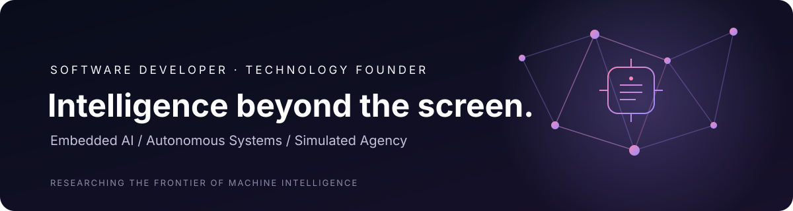

<!-- Profile README: Benjamin | Software Developer & Technology Founder -->

  

<h1 align="center">Benjamin</h1>

  <strong>Software Developer · Technology Founder · AI Systems Researcher</strong>

  Exploring how advanced machine intelligence can move beyond conversation
  and interact with devices, software, and the physical world.

---

## About

I build software at the intersection of **artificial intelligence, embedded computing, and autonomous systems**. My long-term research direction is to bring increasingly capable machine intelligence closer to real-world device control through reliable, secure, and well-defined interfaces.

I am interested in the engineering foundations that could contribute to more general intelligent systems: contextual reasoning, tool orchestration, constrained agency, machine perception, and the connection between high-level models and low-level capabilities.

## Research & Engineering

- **AGI-oriented research** — exploring architectures and engineering pathways toward more general-purpose intelligent systems.
- **Embedded AI & edge intelligence** — bringing useful machine intelligence closer to devices and resource-constrained environments.
- **Simulated agency** — investigating goal-directed behaviour, decision-making, feedback, and controlled autonomy in advanced machine-learning applications.
- **Native device intelligence** — connecting AI systems to operating-system and hardware capabilities through typed, permission-aware interfaces.
- **Autonomous systems** — designing orchestration, execution policies, and feedback loops that keep intelligent systems observable and controllable.

## Current flagship direction — Clark

**Clark** is an AI-driven native Android automation platform. Its direction is to connect AI reasoning with native device capabilities through a structured capability layer—not simply to provide another chatbot or voice assistant.

The architecture emphasizes:
- Native Android operations and typed in-app interfaces.
- Explicit permissions, authorization, and confirmation before sensitive actions.
- Structured execution results and observable workflows.
- A modular capability system that can grow over time.
- A voice-and-text interaction model, with voice as one interface rather than the whole product.

> The goal: move from systems that only describe actions to systems that can safely coordinate and perform authorized actions in the real world.

## Areas of Interest

`Artificial Intelligence` · `AGI Research` · `Embedded AI` · `Machine Learning` · `Edge Computing` · `Autonomous Systems` · `Android Engineering` · `AI Agents` · `Human–Machine Interaction`

## Technology

  
  
  
  
  
  

---

  <em>Building toward a future where machine intelligence is not confined to the screen, but can understand, coordinate, and act through the systems around it—safely and deliberately.</em>

